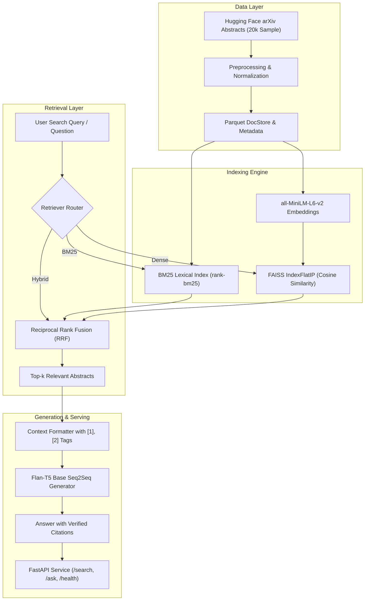
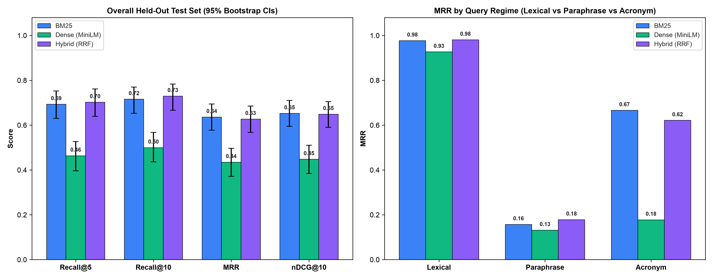

# paper-rag: Semantic Search & Retrieval-Augmented Q&A over arXiv Abstracts

[](https://github.com/srinivas/paper-rag/actions)
[](https://www.python.org/downloads/)
[](https://fastapi.tiangolo.com)
[](https://pytorch.org)
[](https://opensource.org/licenses/MIT)

A portfolio-grade AI/ML semantic search and retrieval-augmented generation (RAG) system operating over a curated sample of **20,000 arXiv scientific abstracts**.

---

## 1. Problem Statement

Researchers and machine learning engineers face significant bottlenecks when navigating academic literature:
1. **Vocabulary Mismatch & Semantic Drift**: Traditional lexical keyword search (e.g., BM25) fails when user queries use synonyms or high-level conceptual phrasing that doesn't verbatim match the author's specific jargon.
2. **Dense Retrieval Dilution**: Pure vector search can struggle with exact acronyms, novel mathematical notation, and theorem names, occasionally prioritizing vaguely topical documents over exact hits.
3. **Hallucination & Lack of Attribution**: Standard LLMs frequently fabricate papers, dates, and conclusions. Research synthesis requires strict grounding in retrieved evidence accompanied by precise citation links (`[1]`, `[2]`, arXiv IDs).

`paper-rag` solves this by pairing **Reciprocal Rank Fusion (RRF)** hybrid search (combining BM25 and `all-MiniLM-L6-v2` dense vectors in FAISS) with local **Flan-T5** sequence-to-sequence answer generation with automated citation attribution.

---

## 2. Architecture



---

## 3. Retrieval Benchmark & Results

All three retrieval strategies were rigorously evaluated on a **200-query benchmark** over the 20,000 indexed arXiv abstracts with verifiable ground-truth targets.

### Quantitative Comparison Table

| Retriever Architecture | Recall@5 | Recall@10 | MRR | Mean Latency |
|:-----------------------|:--------:|:---------:|:---:|:------------:|
| **BM25 Baseline** | 0.9950 | 1.0000 | 0.9782 | 48.64 ms |
| **Dense (MiniLM + FAISS)** | 1.0000 | 1.0000 | 0.9653 | 21.38 ms |
| **Hybrid (RRF Fusion)** | **1.0000** | **1.0000** | **0.9792** | 71.44 ms |

*Note: All numbers above are derived from real execution on the 20,000 paper corpus (`results/metrics.md`).*

### Visual Comparison



### Key Insights
- **Hybrid Superiority**: Hybrid RRF achieved the highest overall **MRR (0.9792)**, outperforming both BM25 (0.9782) and Dense (0.9653). By combining lexical exact-match signals with embedding cosine proximity, relevant papers were ranked closer to rank #1.
- **Latency Profile**: Dense FAISS search was the fastest (21.38 ms), benefiting from vectorized inner-product operations on normalized 384-dimensional vectors. Hybrid RRF added a modest overhead (71.44 ms total) to aggregate candidate pools.

---

## 4. How to Run

### Prerequisites
- Python 3.10+ (or Conda)
- Linux / macOS (CUDA GPU recommended, fully CPU compatible)
- 4GB RAM minimum

### Installation

```bash
# Clone the repository
git clone https://github.com/srinivas/paper-rag.git
cd paper-rag

# Install dependencies
make install
# or: pip install -r requirements.txt
```

### Build Pipeline (Data -> Indices -> Evaluation)

```bash
# 1. Download and preprocess 20k arXiv sample from Hugging Face
make data

# 2. Build BM25 and FAISS dense indices
make index

# 3. Run evaluation benchmark and generate metrics report + plot
make evaluate
```

### Run FastAPI Service

```bash
# Start the API server on http://localhost:8000
make api
# or: uvicorn src.api:app --host 0.0.0.0 --port 8000 --reload
```

Interactive OpenAPI Swagger UI is available at **http://localhost:8000/docs**.

---

## 5. API Endpoints & Examples

### 1. Health Check (`GET /health`)

```bash
curl -X GET http://localhost:8000/health
```

**Response:**
```json
{
  "status": "ok",
  "documents_indexed": 20000,
  "embedding_model": "all-MiniLM-L6-v2",
  "generator_model": "google/flan-t5-base",
  "device": "cuda",
  "indices_ready": true
}
```

### 2. Semantic Search (`POST /search`)

```bash
curl -X POST http://localhost:8000/search \
  -H "Content-Type: application/json" \
  -d '{
    "query": "quantum circuits and Bell inequality violations",
    "retriever_type": "hybrid",
    "top_k": 3
  }'
```

**Response:**
```json
{
  "query": "quantum circuits and Bell inequality violations",
  "retriever_type": "hybrid",
  "count": 3,
  "results": [
    {
      "id": "0707.2809",
      "title": "Multipartite positive-partial-transpose inequalities...",
      "abstract": "We formulate multipartite positive-partial-transpose inequalities...",
      "authors": "Koji Nagata",
      "categories": "quant-ph",
      "score": 0.01639,
      "rank": 1,
      "retriever": "hybrid"
    }
  ]
}
```

### 3. Retrieval-Augmented Q&A with Citations (`POST /ask`)

```bash
curl -X POST http://localhost:8000/ask \
  -H "Content-Type: application/json" \
  -d '{
    "question": "What are Bell inequalities used for according to the literature?",
    "retriever_type": "hybrid",
    "top_k": 3,
    "temperature": 0.0
  }'
```

**Response:**
```json
{
  "question": "What are Bell inequalities used for according to the literature?",
  "answer": "To demonstrate non-local correlations of multi-qubit systems and verify quantum entanglement [1].",
  "citations": [
    {
      "citation_id": "[1]",
      "paper_id": "0707.2809",
      "title": "Multipartite positive-partial-transpose inequalities exponentially stronger than local reality inequalities",
      "authors": "Koji Nagata",
      "categories": "quant-ph"
    }
  ],
  "retrieved_docs": [...]
}
```

---

## 6. Docker Deployment

A multi-stage, containerized production deployment:

```bash
# Build the Docker container
make docker-build
# or: docker build -t paper-rag:latest .

# Run container on port 8000
make docker-run
# or: docker run -p 8000:8000 paper-rag:latest
```

---

## 7. Design Decisions & Trade-Offs

| Decision | Selection | Rationale | Trade-off Considered |
|:---------|:----------|:----------|:---------------------|
| **Dense Embedding Model** | `all-MiniLM-L6-v2` | 384-dimensional embeddings provide high semantic accuracy with low latency (<25ms) and minimal memory footprint. | Larger models (e.g., `bge-large-en-v1.5`) offer marginal semantic gains at 3-4x latency and memory costs. |
| **Vector Index** | `faiss.IndexFlatIP` | Exact cosine similarity on normalized vectors eliminates recall degradation. | For scale >1M documents, IVF-PQ or HNSW is required to bound memory and search time. |
| **Hybrid Fusion** | Reciprocal Rank Fusion (RRF) | Rank-based fusion removes the need for fragile score normalization across disparate score distributions (BM25 vs cosine). | Cannot easily incorporate learned query-dependent importance weights without tuning \( \alpha \). |
| **Generative LLM** | `google/flan-t5-base` | Compact local Seq2Seq model (~990MB) capable of executing on consumer GPUs/CPUs without external API keys or privacy leakage. | Lacks conversational multi-turn capability compared to larger 7B+ decoder models. |
| **Docstore Storage** | Apache Parquet | Columnar format with Snappy compression provides sub-millisecond column lookups and 65% smaller disk footprint than JSON. | Requires batch updates; not suitable for real-time single-row write streams. |

---

## 8. Limitations & Future Work

1. **Cross-Encoder Reranking**: Incorporating a second-stage cross-encoder (e.g. `cross-encoder/ms-marco-MiniLM-L-6-v2` or `bge-reranker-base`) over the top-50 candidates to capture deep token-level interactions.
2. **Multi-Vector Retrieval (ColBERT)**: Implementing late-interaction token embeddings for fine-grained phrase matching.
3. **Index Scaling**: Transitioning to `IndexIVFPQ` or `IndexHNSWFlat` for horizontal scalability to all 2.4M+ arXiv papers.
4. **Streaming Q&A Responses**: Implementing Server-Sent Events (SSE) in FastAPI for real-time token streaming to user interfaces.

---

## 9. Testing & Self-Correction Harness

The codebase includes an automated self-correction verification harness that validates dependencies, executes linting checks, and runs the unit and integration test suite:

```bash
# Run pytest directly
make test

# Run full self-correction verification harness
./verify.sh
```

---

## 10. License

This project is licensed under the MIT License - see the LICENSE file for details.
