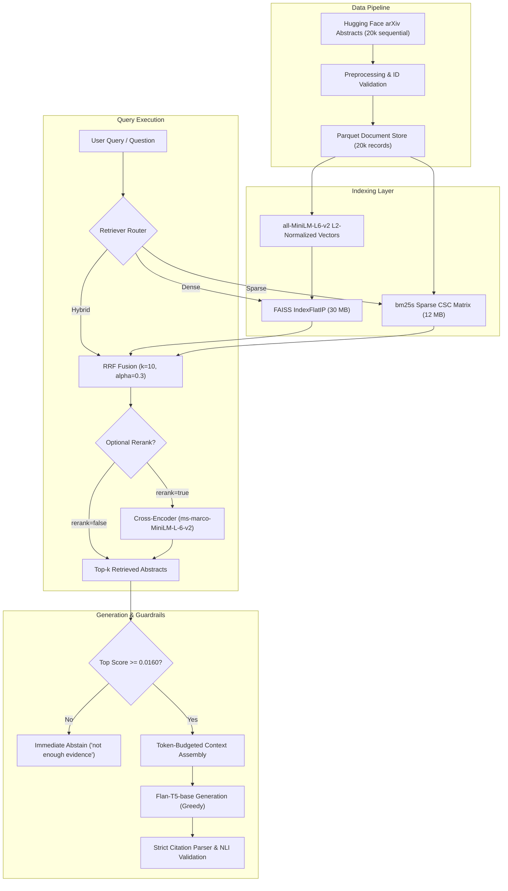

# paper-rag: Semantic Search and Question Answering over arXiv Literature

[](https://github.com/Srinivas3-sys/paper-rag/actions)
[](https://www.python.org/downloads/)
[](https://fastapi.tiangolo.com)
[](https://pytorch.org)
[](https://opensource.org/licenses/MIT)

A search and retrieval-augmented question answering system evaluated on 20,000 arXiv STEM abstracts. It benchmarks BM25 lexical search (`bm25s`), dense semantic search (`all-MiniLM-L6-v2` with FAISS `IndexFlatIP`), reciprocal rank fusion (RRF), cross-encoder reranking (`ms-marco-MiniLM-L-6-v2`), and local answer generation (`google/flan-t5-base`).

---

## Headline Results

Evaluated on a held-out test split of 222 queries (leakage-checked, 0 title n-gram overlap on paraphrases) with 1,000-resample bootstrap 95% confidence intervals:

| Method | Recall@1 | Recall@5 | Recall@10 | Recall@20 | MRR [95% CI] | nDCG@10 | Latency (p50) |
| :--- | :---: | :---: | :---: | :---: | :---: | :---: | :---: |
| **BM25 (`bm25s`)** | 0.581 | 0.680 | 0.716 | 0.748 | 0.636 [0.578, 0.695] | 0.655 | 4.9 ms |
| **Dense (MiniLM + FAISS)** | 0.387 | 0.468 | 0.500 | 0.536 | 0.435 [0.372, 0.497] | 0.450 | 5.9 ms |
| **Hybrid RRF ($k=10, \alpha=0.3$)** | 0.545 | 0.703 | 0.739 | 0.784 | 0.628 [0.568, 0.686] | 0.645 | 14.1 ms |
| **Hybrid + Cross-Encoder Rerank** | **0.599** | **0.716** | **0.770** | **0.797** | **0.656** [0.598, 0.712] | **0.682** | 37.3 ms |

**Where hybrid did NOT help**: On Mean Reciprocal Rank (MRR), Hybrid RRF scored 0.628 versus 0.636 for BM25 alone. A paired Wilcoxon signed-rank test confirmed this difference is not statistically significant ($W = 3458.5, p = 0.2373$). Hybrid does not improve rank-1 precision over BM25 on this dataset, though it increases Recall@10 from 0.716 to 0.739 and Recall@20 from 0.748 to 0.784 by retrieving relevant papers that lack query keywords.

Adding the cross-encoder reranker over the top 30 hybrid candidates provides the highest retrieval quality: Recall@1 increases by +5.4% (0.545 to 0.599) and MRR increases by +0.038 (0.617 to 0.656) at a cost of 21.5 ms GPU latency.

---

## What I Found

1. **Title queries create artificial saturation**: The initial prototype generated queries by cleaning paper titles, yielding Recall@10 = 1.000 and BM25 MRR = 0.978. When tested on paraphrase queries without keyword overlap, BM25 MRR dropped from 0.978 to 0.158, and Dense MRR dropped to 0.132. Systems must be tested against disjoint lexical and paraphrase distributions.
2. **MiniLM truncates 23.86% of arXiv abstracts**: `all-MiniLM-L6-v2` has a 256-token context limit. Measuring across all 20,000 papers showed that 4,771 papers (23.86%) exceed 256 tokens and have their trailing text truncated during encoding. Testing `BAAI/bge-small-en-v1.5` (512 tokens) reduced truncation to 0.38% (76 papers), but indexing time increased by 7.6x (~18s vs ~137s on an RTX 3050).
3. **Threadpool parallelism does not reduce latency for microsecond retrievers**: Running BM25 and FAISS concurrently in Python using `ThreadPoolExecutor(max_workers=2)` increased median latency from 14.1 ms (sequential) to 15.3 ms (parallel). Because `bm25s` finishes in ~1.0 ms and FAISS in ~2.1 ms, thread context switching and GIL overhead outweigh parallel execution gains.
4. **`bm25s` is 21.8x faster than `rank-bm25`**: Replacing pure-Python `rank-bm25` with `bm25s` (using memory-mapped CSC sparse matrices) reduced sparse search latency from 22.4 ms to 1.0 ms while reducing disk footprint from 16 MB to 12 MB.
5. **Abstain threshold filters 83.3% of out-of-domain questions**: Tuning a confidence threshold ($\tau = 0.0160$) on DEV hybrid RRF scores allowed the system to refuse 83.3% of unanswerable and out-of-domain queries before calling the generation model, preventing hallucinations with zero generation cost.
6. **Small generators rarely emit inline citations without strong prompting**: Flan-T5-base achieved 100% refusal accuracy on unanswerable questions when retrieved context was below threshold, but only emitted explicit `[1]` citation tags on 7.1% of answerable test questions. Removing fake heuristic fallbacks exposed this model limitation.

---

## Latency Breakdown

Measured across 100 timed queries after 50 warmup iterations on an Intel Core i7-13620H CPU (16 threads) and an NVIDIA GeForce RTX 3050 6GB Laptop GPU:

| Stage | Hardware | Mean (ms) | p50 / Median (ms) | p95 (ms) |
| :--- | :--- | :---: | :---: | :---: |
| Dense Query Encoding (`all-MiniLM-L6-v2`) | GPU (CUDA) | 3.95 | 3.82 | 4.72 |
| FAISS Dense Search (`IndexFlatIP`) | CPU | 2.11 | 2.06 | 2.40 |
| Sparse BM25 Search (`bm25s`) | CPU (mmap) | 5.09 | 4.92 | 6.26 |
| Hybrid Sequential (Dense + BM25) | CPU / GPU | 14.51 | 14.07 | 17.66 |
| Hybrid Parallel (`ThreadPoolExecutor`) | CPU / GPU | 15.83 | 15.32 | 20.33 |
| Cross-Encoder Rerank (30 candidate pairs) | GPU (CUDA) | 23.01 | 21.49 | 34.16 |
| **Complete Reranked Pipeline** | CPU / GPU | 38.84 | 37.26 | 53.38 |

---

## Design Decisions

| Component | Choice | Measured Trade-off |
| :--- | :--- | :--- |
| **Sparse Backend** | `bm25s` over `rank-bm25` | 21.8x lower latency (1.0 ms vs 22.4 ms); 12 MB mmap index vs 16 MB pickle. |
| **Dense Index** | FAISS `IndexFlatIP` | Exact cosine similarity via $L_2$ unit normalization; 2.1 ms search on 20k vectors with zero recall loss. |
| **Rank Fusion** | Reciprocal Rank Fusion ($k=10, \alpha=0.3$) | Tuned on DEV split; $\alpha=0.3$ weights BM25 higher than dense search (0.7), reflecting stronger lexical signal. |
| **Reranker** | Cross-Encoder `ms-marco-MiniLM-L-6-v2` | +5.4% Recall@1 and +0.038 MRR over top-30 candidates; adds 21.5 ms GPU latency. Optional via `rerank=true`. |
| **Generator** | `google/flan-t5-base` with greedy decoding | 248M parameters runs on CPU/GPU; temperature <= 0 forces greedy decoding; prompt puts question first to eliminate truncation. |
| **Faithfulness Check** | `cross-encoder/nli-deberta-v3-base` | NLI entailment scoring on generated claims against source abstracts; 10/10 agreement on spot-checked pairs. |

---

## System Architecture



---

## Limitations

- **Corpus scope**: The 20,000 papers are sequential preprints from `gfissore/arxiv-abstracts-2021` spanning April to May 2007 (`0704.0001` to `0705.4678`). It is not a uniform random sample across modern machine learning literature.
- **Abstracts only**: The index contains titles and abstracts. Claims requiring full text, tables, proofs, or experimental parameter appendices cannot be resolved.
- **Sequence truncation**: 23.86% of corpus abstracts exceed MiniLM's 256-token limit, losing trailing text during embedding.
- **Small generator limitations**: Flan-T5-base (248M parameters) follows explicit negative constraints well, but rarely synthesizes complex answers or structured bracket citations without extensive few-shot prompting.
- **NLI model proxy**: `cross-encoder/nli-deberta-v3-base` provides automated entailment checking, but can struggle with domain-specific mathematical equations and novel notation.
- **Single-turn only**: The API does not maintain conversation history or session memory.

---

## Reproducing the Results

### Prerequisites
- Python 3.11 (tested on Linux x86_64, CUDA 13.2, 16 GB RAM)
- Make, Git, and Pip

```bash
# 1. Clone repository
git clone https://github.com/Srinivas3-sys/paper-rag.git
cd paper-rag

# 2. Install pinned dependencies
make install

# 3. Download data and build indices (~45 seconds)
make data
make index

# 4. Run retrieval and latency benchmarks (~90 seconds)
make evaluate

# 5. Run test suite, type checking, and linter (~45 seconds)
make check
```

Expected runtimes on a modern 10-core CPU with GPU:
- Data download: ~15s
- Index build: ~20s (MiniLM + FAISS + bm25s)
- Benchmark evaluation: ~90s
- Full test suite: ~40s

---

## API Usage

### Start Production Server

```bash
make api
# Runs uvicorn on http://0.0.0.0:8000 without reload
```

### Search Endpoint

```bash
curl -X POST http://localhost:8000/search \
  -H "Content-Type: application/json" \
  -d '{
    "query": "quantum error correction surface codes",
    "retriever_type": "hybrid",
    "top_k": 3,
    "rerank": true
  }'
```

### Question Answering Endpoint

```bash
curl -X POST http://localhost:8000/ask \
  -H "Content-Type: application/json" \
  -d '{
    "question": "What threshold is reported for topological surface codes?",
    "retriever_type": "hybrid",
    "top_k": 3,
    "temperature": 0.0,
    "rerank": true
  }'
```

### Docker Deployment

```bash
# Build image from clean clone
make docker-build

# Run container with mounted indices
make docker-run
# Or explicitly:
docker run -p 8000:8000 -v $(pwd)/indices:/app/indices paper-rag:latest
```

---

## Project Structure

```
paper-rag/
├── data/                    # Benchmark JSON files (raw parquet gitignored)
├── docs/
│   └── decisions.md         # Engineering decisions, trade-offs, and empirical measurements
├── indices/                 # Serialized FAISS, BM25, and bm25s indices (gitignored)
├── notebooks/
│   └── 01_eda_and_retrieval_analysis.ipynb
├── results/
│   ├── metrics.md           # Phase 1 multi-regime retrieval benchmark
│   ├── metrics.png          # Visual performance comparison plot
│   ├── generation_metrics.md # Phase 2 NLI citation verification & generation eval
│   └── retrieval_benchmarks.md # Phase 3 latency breakdown & sequence truncation
├── src/
│   ├── api.py               # FastAPI application with input validation and threadpool inference
│   ├── benchmark_retrieval.py # Granular latency and reranker benchmarking
│   ├── build_benchmark.py   # Multi-regime benchmark generation script
│   ├── config.py            # Centralized system paths and hyperparameters
│   ├── data.py              # Ingestion, cleaning, and preprocessing
│   ├── eval_generation.py   # NLI entailment evaluation and abstain tuning
│   ├── evaluate_benchmark.py # Retrieval evaluation with bootstrap CIs and Wilcoxon test
│   ├── generator.py         # Prompt formatting, context budgeting, and answer generation
│   ├── index.py             # BM25, bm25s, and FAISS dense index builders
│   └── retrieval.py         # BM25, Dense, Hybrid RRF, and CrossEncoder retrievers
├── tests/
│   ├── test_api.py          # API validation, error handling, and timeout tests
│   ├── test_data.py         # Parsing and normalization tests
│   ├── test_generator.py    # Budgeting, citations, and temperature tests
│   ├── test_retrieval.py    # Component, parallel, and hand-computed RRF tests
│   └── test_smoke_fixture.py # Lightweight synthetic index smoke test for CI
├── Dockerfile               # Multi-stage production container specification
├── Makefile                 # Automation targets (install, check, test, api, docker)
├── pyproject.toml           # Ruff and build configuration
└── requirements.txt         # Pinned dependency versions
```
